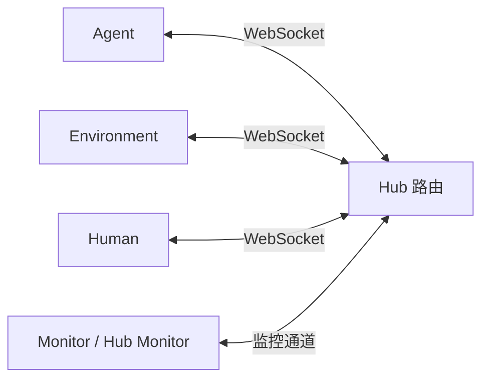
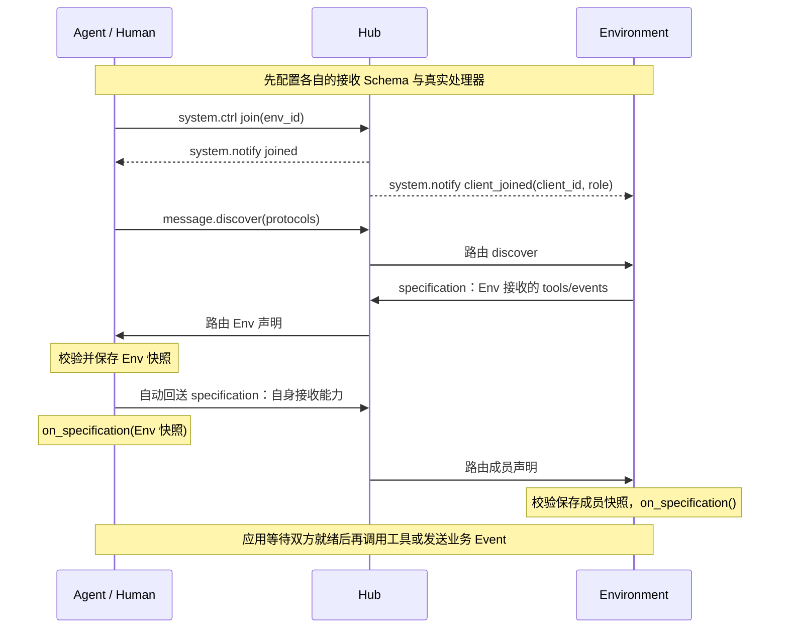
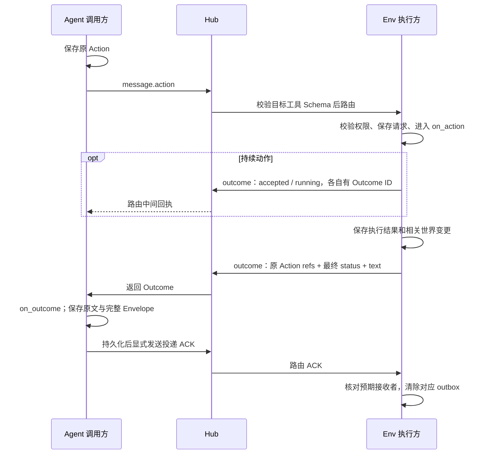

# Star Protocol 规范

| 项目 | 当前约定 |
|---|---|
| 应用协议 | `agent-env-compact/2` |
| 对应实现 | Python SDK `0.3.0`，基准提交 `e29e2ee` |
| 传输 | WebSocket，JSON |
| 消息结构 | Envelope → Payload → Content |
| 更新日期 | 2026-10-10 |

本文描述当前 SDK 与 Hub 实现使用的协议。应用协议版本、SDK 包版本和业务 Schema 的版本分别管理。本文替代旧版 `success/ref_id`、任意业务 `data` 及单向工具发现规则。

- [1. 主体与连接](#1-主体与连接)
- [2. 三层消息结构](#2-三层消息结构)
- [3. 本地注册与双向协商](#3-本地注册与双向协商)
- [4. Action 与 Outcome](#4-action-与-outcome)
- [5. Event 与解析方式](#5-event-与解析方式)
- [6. 路由与广播](#6-路由与广播)
- [7. 投递确认与恢复](#7-投递确认与恢复)
- [8. System、Stream 与 Monitor](#8-systemstream-与-monitor)
- [9. 实现职责与验证入口](#9-实现职责与验证入口)

## 1. 主体与连接

Hub 负责会话、环境成员关系和路由。业务通过独立的客户端接收契约表达。

| 主体 | 功能 |
|---|---|
| Agent | 观测、调用工具、接收结果、发送自身行为与发言；应用决定如何使用模型 |
| Environment（Env） | 提供环境能力与接收契约，执行业务、发布事实及反馈 |
| Human | 通过应用界面交互；是否允许调用某个工具由业务授权决定 |
| Monitor | 订阅客户端遥测，接收 `monitor` 消息 |
| Hub Monitor | 通过独立监控连接观察通过入口校验的非 `monitor` 报文 |



连接端点为 `ws://<host>:<port>/ws/<role>/<client_id>`；部署 TLS 时使用 `wss://`。`role` 为 `agent / environment / human / monitor / hub_monitor`。SDK 的 `connect()` 接收基础 URL，例如 `ws://127.0.0.1:8765`，自动拼接端点。

Environment 连接时建立以自身 `client_id` 命名的环境，不需要再次 `join`。Agent/Human 的业务成员状态通常为 `disconnected → home → in_env`。Monitor 在未加入环境时也能使用监控通道。

成员用 `system.ctrl` 加入或离开环境；业务调用还需完成第 3 节的能力协商。本地 `join_environment()` 发送后会乐观更新状态，不能替代 Hub 的 `joined` 确认。Agent 可用 `join_with_retry()` 等待确认；应用也可显式等待通知。

Hub 将 `Envelope.sender` 与连接路径中的 `client_id` 绑定，拒绝不一致的发送者。当前示例 Hub 没有账号或 Token 鉴权；部署时的身份认证由应用提供。

## 2. 三层消息结构

- **Envelope**：谁发送、发给谁、采用哪一类 Payload，以及物理投递的 ID 和时间。
- **Payload**：用 `type` 选择 Content 的解析规则。
- **Content**：消息语义、逻辑身份、因果关联和正文或调用参数。

### 2.1 Envelope

Wire 中以下六个字段全部必填，不允许额外字段。

| 字段 | 类型与约束 | 含义 |
|---|---|---|
| `id` | UUID 字符串 | 物理投递身份；SDK 默认生成 UUIDv4，解析器接受合法 UUID，不限定 v4 |
| `timestamp` | 非负整数 | 发送时间，Unix 毫秒；不是可靠排序或重放游标 |
| `type` | `system / message / broadcast / monitor` | 决定 Payload 类型 |
| `sender` | 字符串，1..256 字符 | 连接主体的 ID |
| `recipient` | 字符串，1..256 字符 | 客户端 ID、控制目标 `hub` 或当前环境广播目标 `@env` |
| `payload` | 对象 | 必须与 Envelope.type 匹配 |

本地构造 `Envelope` 可自动生成 `id/timestamp` 并默认 `type="message"`；接收 wire 不补齐缺失字段。

```json
{
  "id": "550e8400-e29b-41d4-a716-446655440001",
  "timestamp": 1791590400000,
  "type": "message",
  "sender": "agent_01",
  "recipient": "env_main",
  "payload": {
    "type": "discover",
    "content": {"protocols": ["agent-env-compact/2"]}
  }
}
```

### 2.2 Payload

Payload 只允许 `type` 和 `content`；`content` 必须是 JSON 对象。

| Envelope.type | 允许的 Payload.type | 用途 |
|---|---|---|
| `system` | `ctrl / notify / error` | 加入、离开、成员通知、投递确认、协议错误 |
| `message` | `discover / specification / action / outcome / event / stream` | 定向协商与业务交互 |
| `broadcast` | `event / stream` | 当前环境成员广播 |
| `monitor` | `ctrl / data / notify` | 监控控制、遥测与确认 |

`action/outcome/event/discover/specification` 使用精确的 Content 字段规则。`system/monitor/stream` 保留原生 Star 可扩展 JSON 对象；第 8 节列的是当前实现约定，不能等同于已安装完整的 compact Schema。

### 2.3 JSON 与身份约束

接收 JSON 拒绝重复键和 `NaN/Infinity`；Content 必须是有限 JSON 值，不接收 tuple 等 Python 专有值。Envelope 经模型规范化、以紧凑 JSON 重新编码后的 UTF-8 大小不得超过 **512 KiB**；此检查不等同于原始 WebSocket 字节大小限制。

Action、Outcome、Event 的 `content.id` 为 1..256 字符的逻辑 ID，不要求 UUID 格式。发送方应在首次发送前生成并保存；`gen_id("action" / "outcome" / "event")` 提供默认生成方式。逻辑 ID 在同一记录空间内不可跨类型复用，也不可改变原 Content。

`Envelope.id` 与 `Content.id` 用途不同：重发同一逻辑 Action/Outcome 可以使用新的 Envelope；重放同一待确认物理投递，必须保留原 Envelope 的 ID、时间和完整内容。Hub 不替缺失的逻辑 ID 生成新 ID。

## 3. 本地注册与双向协商

### 3.1 接收方声明

每个主体先注册自己能接收的能力，再向对方公布完整快照。`specification` 的 Content 必须且只包含：

| 字段 | 约束 |
|---|---|
| `protocol` | 本实现选择 `agent-env-compact/2` |
| `tools` | 0..256 个工具定义；同目录的名称唯一 |
| `events` | 0..256 个 Event 定义；同目录的名称唯一 |

| 定义 | 必填字段 | 可选字段 |
|---|---|---|
| Tool | `name`、`description`、`parameters`（参数 Schema 对象） | `tags`（字符串数组） |
| Event | `name`、`description`、`handler`（`model / runtime`） | `data_schema`（data Schema 对象） |

`name` 为 1..128 字符，`description` 为 1..32000 字符；每个 `tags` 项为 1..128 字符。不增加 `output_schema/params_schema` 等平行字段。无参工具仍提供 Schema，并使用 `params: {}`。

Schema 使用 JSON Schema Draft 2020-12，实例校验启用 `FormatChecker`。支持本地 `$defs`、`$ref` 和 `$dynamicRef`；引用必须以 `#` 开头，不隐式读取外部 Schema。需要禁止额外业务字段时，在 Schema 中明确设置 `additionalProperties: false`；SDK 不自动给任意 Schema 添加此约束。省略 Event 的 `data_schema` 表示只接收 `{text}`，而不是允许任意对象。

下面是一个 Environment 的完整接收快照（此处展示 Content）：

```json
{
  "protocol": "agent-env-compact/2",
  "tools": [
    {
      "name": "set_light",
      "description": "设置灯光开关。",
      "parameters": {
        "type": "object",
        "properties": {"on": {"type": "boolean"}},
        "required": ["on"],
        "additionalProperties": false
      }
    }
  ],
  "events": [
    {"name": "speech", "description": "接收自然语言发言。", "handler": "model"},
    {
      "name": "activity.state",
      "description": "接收主体自身活动状态。",
      "handler": "runtime",
      "data_schema": {
        "type": "object",
        "properties": {
          "text": {"type": "string", "minLength": 1, "maxLength": 32000},
          "state": {"enum": ["idle", "working", "listening"]}
        },
        "required": ["text", "state"],
        "additionalProperties": false
      }
    }
  ]
}
```

`configure_capabilities(tools=..., events=..., runtime_handlers=...)` 安装本地接收契约。runtime Event 必须已有异步处理器，签名为 `(sender, full_content)`；仅写 `"handler": "runtime"` 不会安装行为。单播 model Event 进入 `on_event()`，具备广播分派的客户端使用 `on_broadcast_event()`；runtime Event 由统一接收校验入口分派。Tool Schema 约束参数，实际执行由接收客户端的 `on_action()` 分派；工具声明不会自动生成函数。

Agent/Human 通常不提供工具，可用 `tools: []` 声明模型输入及 runtime 反馈。具备 Outcome 分派的调用方使用框架 `on_outcome()` 接收结果，不属于 Event 或 Tool 注册。接收远端快照只建立调用/发送契约，不安装远端函数。

### 3.2 协商顺序

`discover` Content 只包含 `protocols`：1..8 个不重复的非空版本字符串，每项最多 64 字符。本 SDK 发出 `["agent-env-compact/2"]`；不兼容的协议不能启用业务交互。



同环境内 Agent↔Agent、Agent↔Human 私聊也各自交换声明；不能用 Agent↔Env 的协商替代另一对主体的契约。

SDK 先保存收到的快照，再按需自动发送反向声明，最后调用 `on_specification()`。因此回调可能晚于反向声明发送，不能把回调时间当作网络到达时间。

`protocol_for(peer)` 表示本端已发送自身声明并收到对端声明；它不证明对端处理器已经完成安装回调。Hub 收到两个方向的声明后才放行 Action/Outcome/Event；应用就绪流程仍应确认双方已接收并准备好处理。多对端场景用 `specification_for(peer)` 读取对应快照。

声明是完整快照，不是增量补丁。新增 `discover` 会使该对主体的旧契约失效；重连清除本地协商缓存，必须重新交换。普通 `leave` 不等同于清空全部本地历史，重新加入时仍应显式重新协商。能力变更先更新真实本地行为，再向每个相关对端重新发布接收快照。

## 4. Action 与 Outcome

### 4.1 Action：请求执行已声明工具

Content 只能包含以下三个必填字段：

| 字段 | 约束 |
|---|---|
| `id` | 本次动作的不可变逻辑 ID |
| `name` | 接收方已声明的工具名，1..128 字符 |
| `params` | JSON 对象，按该接收工具的 `parameters` 校验；无参也必须为 `{}` |

```json
{"id": "action-light-001", "name": "set_light", "params": {"on": true}}
```

典型方向为 Agent/Human→Env。Hub 不通过角色统一禁止 Human 调用工具，业务权限由接收方处理。其他方向需要接收方声明工具并实现真实 Action 处理；路由可达不代表默认客户端已实现该业务。

同一 Action 重试保留原 `id/name/params` 和目标；SDK 校验原调用者、目标及内容不变。重复 Action 仍进入 `on_action()`，环境应先查持久账本、重放原 Outcome，避免重复执行。SDK 的内存去重不提供执行幂等或外部事务保证。

交易 `exchange_id`、取消或查询的 `action_id` 等可以是工具 Schema 约束的业务参数，它们不替代本次 `content.id`。

### 4.2 Outcome：同一 Action 的结果流

Content 必须且只包含 `id/refs/status/data`。

| 字段 | 约束 |
|---|---|
| `id` | 本条 Outcome 的不可变逻辑 ID；每条中间回执和最终回执分别生成 |
| `refs` | 恰好一个逻辑 Action ID；不是原 Action 的 Envelope UUID |
| `status` | 下表六种状态之一 |
| `data` | 只允许 `{"text": "自然语言结果或原因"}`；text 为 1..32000 字符 |

| status | 含义 | 是否终态 |
|---|---|---|
| `accepted` | 已接受，尚未确认完成 | 否 |
| `running` | 正在持续执行 | 否 |
| `completed` | 执行完成 | 是 |
| `rejected` | 请求被拒绝，例如权限或业务前提不满足 | 是 |
| `failed` | 执行失败，原因写入 text | 是 |
| `cancelled` | 已确认取消或终止 | 是 |

```json
{
  "id": "outcome-light-001",
  "refs": ["action-light-001"],
  "status": "completed",
  "data": {"text": "灯光已打开。"}
}
```

Outcome 不使用 `success/ref_id/error/epoch/code/effect/retry`；结果及失败原因用 text 表达，后续决策由调用方完成。

Action 可以直接获得终态，也可以得到多个 `accepted/running` 中间结果，最后产生一个终态。中间状态不要求固定三阶段，也不要求每个阶段只出现一次。执行方应在动作结束时提供最终 Outcome；网络或进程故障期间尚无终态，就保留未确认并执行恢复流程，SDK 不会自动补造完成结果。

同一 Action 只接受一个不可变终态 Outcome；原终态的相同 ID/内容重放合法，创建第二个终态 ID 则冲突。终态后迟到的进度仍保存，但不回退最终状态；`running` 后迟到的 `accepted` 也不回退当前进度。



`await_action()` 仅等待终态。超时抛出 `ActionTimeoutError`，其中 `status="unknown"` 是本地未确认状态，不是合法的 wire Outcome.status；它不取消远端动作、不改写已有进度，也不自动重发。等待返回终态也不证明应用已完成持久化或 ACK。

显式取消、查询历史、主动观测都可以是环境声明的工具，但不是协议内置命令。Demo 的 `cancel/get_operation_result/observe` 只是可运行的业务例子；取消请求自身也有独立 Action 与 Outcome。

## 5. Event 与解析方式

### 5.1 统一 Content

Event 必填 `id/name/data`，可选 `refs`，不允许其他 Content 字段。`name` 为 1..128 字符。身份放在 `content.id/name`；`data` 必须是含自然语言 `text` 的对象，不是 JSON 字符串，也不是裸字符串。

无接收方专用 Schema 时，data 只能包含 text：

```json
{
  "id": "event-observation-001",
  "name": "observation",
  "data": {"text": "门口出现一个人，正在等待回应。"}
}
```

普通未声明名称也按这一默认规则进入模型输入。要附加字段，必须使用接收方已经向该发送者声明的 `data_schema`；不允许靠事件名称猜结构。即使使用专用 Schema，text 仍必填且为 1..32000 字符。`data` 顶层不能出现 `id/event_id/event_type`。

Activity 是 Event 的业务语义，不是新 Payload 类型。例如 Agent 通知 Env 自身活动状态：

```json
{
  "id": "event-state-001",
  "name": "activity.state",
  "data": {"text": "我正在观察房间。", "state": "working"}
}
```

该例由第 3 节的接收 Schema 约束。发言、反应等行为可以通过各自 Event 表达；有结构化控制字段时同样声明 Schema，不新增通用的 `state_change` 消息类型。

### 5.2 refs：有序的 Event 因果关联

Event.refs 若省略，表示未显式给出因果关联；若提供，必须有 1..32 个不重复的逻辑 Event ID，不能引用自身。`[]` 不合法，顺序保持发送方给定的顺序。

```json
{
  "id": "event-reply-001",
  "name": "speech",
  "refs": ["event-speech-001", "event-observation-001"],
  "data": {"text": "我听到了；请先看看门口是谁。"}
}
```

通用因果关联放在 `content.refs`，不放入 data。业务 Schema 可以定义 `action_id/exchange_id/conversation_id` 等业务关联键，这些键不承担本 Event 的身份或通用 refs 作用。

SDK 拒绝引用已知的非 Event 记录；未知历史引用保留给应用按权限检索原文。refs 不表示到达顺序、执行顺序或 ACK，也不自动保证引用存在、图无环及依赖消息补齐。

### 5.3 模型与程序如何解析

SDK 按 Envelope.type→Payload.type 校验并分派完整 Content 字典；不是先把全部 JSON 塞进模型再由模型判断协议结构。

| 接收方式 | 实际处理 |
|---|---|
| `handler="model"` 或默认文本 Event | 单播调用 `on_event(sender, content)`，具备广播分派的客户端调用 `on_broadcast_event()`；应用将 data.text 与必要身份、名称、refs 上下文提供给模型 |
| `handler="runtime"` | Schema 校验后调用已安装的异步处理器，程序按确定字段处理控制信息 |
| Outcome | SDK 跟踪结果；具备结果分派的调用方调用 `on_outcome(sender, content)`，程序解析 status/refs，模型读取结果或原因 text |
| Action | 按工具参数 Schema 校验，再进入 `on_action(sender, content)` 执行业务 |

协议不规定模型提示词模板，也不要求整份 Envelope JSON 进入上下文。runtime 的字段校验不代表业务授权；接收方仍需根据真实 sender、环境成员角色与业务状态决定是否处理。

Event 表达通知、观察、反馈或发言；需要确定执行与原请求的结果流时，用 Action。Event 不自动获得 Outcome。Conversation、群组拆分/合并、成员角色和 Interaction 控制流程由业务规范及接收 Schema 定义，当前 SDK 不自动实现这些生命周期。

模型 Event、Outcome 和 runtime Event 在回调成功后才被标记已处理；同原 ID/内容重放通常不再次调用成功的处理器。回调抛错可重试。持久化与重启后的去重仍由应用日志负责。

## 6. 路由与广播

定向 `message` 要求双方有活动连接并位于同一 Environment；Environment 本身视为该环境的业务对端。Action/Outcome/Event 还要求这对主体已有两个方向的声明。

同环境内 Agent↔Agent、Agent↔Human 私聊只投给 `recipient`，不会附送给 Env。Hub Monitor 可通过独立监控通道观察；私聊业务路由与监控访问应分别理解。

`broadcast` 面向当前环境的成员，使用 `recipient="@env"`，排除发送者自身。Environment 不在成员集合里，因此成员广播不会天然投递给 Env。广播保留原 Envelope.id、时间、发送方及 Payload，所有成员收到同一广播投递。

SDK 的广播 Event 只允许基础 `data: {text}`；Hub 逐个检查实际接收成员的双向契约和接收 Schema。需要不同结构、授权范围或专用 runtime 控制时，对各个已协商接收者逐个单播。`@all` 和其他环境目标不是本 compact Event 的公共广播能力。

默认 Agent 客户端处理 Action、Outcome、Event、Stream；Human 默认处理 Outcome、Event、Stream；Environment 默认处理 Action、Event。需要其他接收方向时应扩展相应回调。仅声明能力或 Hub 路由成功不等于该客户端默认实现了处理行为。

## 7. 投递确认与恢复

ACK 确认物理投递已持久接收，不确认 Action 成功执行；执行结果仍由 Outcome 表达。以下是 ACK 的完整 Envelope：

```json
{
  "id": "550e8400-e29b-41d4-a716-446655440009",
  "timestamp": 1791590400100,
  "type": "system",
  "sender": "agent_01",
  "recipient": "env_main",
  "payload": {
    "type": "notify",
    "content": {
      "event": "VILLAGE_DELIVERY_ACK",
      "msg": {"envelope_id": "550e8400-e29b-41d4-a716-446655440008"}
    }
  }
}
```

当前原生名字保留为 `VILLAGE_DELIVERY_ACK`，属于 system 控制通道，不是 compact Event。`msg` 恰好包含 UUID 字段 `envelope_id`，指向被确认的原 Envelope.id。Hub 只允许当前成员向所属活动 Environment 发出该 ACK，尚不提供对称的 Env→成员 ACK 路径。

接收方先校验并持久保存完整 Envelope，再显式调用 `send_delivery_ack(original_sender, envelope.id)`；SDK 不自动保存日志或发送持久 ACK。Env 的 `on_delivery_ack(sender, envelope_id)` 应核对 outbox 的预期接收者，并幂等删除该物理投递。单纯 WebSocket 发送完成不证明已持久接收。

应用恢复时应从持久日志还原逻辑身份、原文及原 Action 绑定，重新建立连接与协商，然后查询已声明的历史工具、重发原 Action 或补发原物理投递。`restore_action()` 和 `restore_received_action()` 只还原 SDK 内存绑定，不读取外部日志、不执行原动作。

Hub 的 Action 所有权记录也是内存状态；重启后不能靠 Hub 猜测旧绑定。收到重放 Outcome 的客户端必须已有对应的原调用者/目标记录。世界变更、原结果与执行去重账本由业务事务保障。

## 8. System、Stream 与 Monitor

### 8.1 System

Hub 控制消息通常发给 `hub`；ACK 是第 7 节的成员→Env 例外。

| Payload.type | 当前 Content 约定 |
|---|---|
| `ctrl` | 加入：`{"op":"join","env_id":"env_main"}`；离开：`{"op":"leave"}` |
| `notify` | `event` 与 `msg`，可带通知专用字段；msg 可以是字符串或对象 |
| `error` | `code` 与自然语言 `msg`，可带 `original_msg_id`、`details` |

Hub 的常用通知包括：`connected`；`joined/left` 携带 `env_id`；发给 Env 的 `client_joined` 在 msg 中包含 `client_id/role`，`client_left` 包含 `client_id/reason`；Env 断开时向成员发送 `environment_closed`。

`system.error` 表示解析、协议或路由等错误，不是业务 Outcome.failed，不能据此补造 Action 终态。本地发送校验失败通常直接抛异常；若未开始网络发送，接收方没有收到该请求。

### 8.2 Stream

原生 Content 常用 `id / sequence / chunk / is_end`；例如下列片段（此处展示 Content）：

```json
{"id": "stream-001", "sequence": 0, "chunk": "正在说明房间状况。", "is_end": false}
```

Stream Content 仍为可扩展对象，当前没有 compact 式的精确字段与必填约束。单播仍受同环境路由限制，但 SDK/Hub 不要求先完成 compact 能力协商。`sequence/is_end` 不触发 SDK 自动重排、去重、补齐、聚合或跨重连恢复；这些机制由应用定义。流片段不替代最终 Outcome。

### 8.3 Monitor

Monitor 不使用 Event 的 data.text 规则，遥测 Content 为独立控制契约。

| Payload.type | 当前 Content 约定 |
|---|---|
| `ctrl` | `op: enable / disable / subscribe / unsubscribe`；启用可带 `level`，订阅/退订使用 `target_client_id` |
| `data` | `name`、`data`、`timestamp`；data 是 JSON 遥测内容 |
| `notify` | `event`、`msg`，以及 `level/target_client_id` 等相关确认字段 |

控制发给 `hub`。确认事件为 `monitoring_enabled / monitoring_disabled / subscribed / unsubscribed`；发送订阅请求不等于 Hub 已确认订阅。

Hub 转发遥测时建立新的 Envelope，以被监控主体为 sender，以实际 Monitor 为 recipient。Hub 的 `message_received` 表示到达 Hub、归于原发送者；`message_sent` 表示离开 Hub、归于目标接收者。SDK 主动报告的同名遥测是不同观察点，不能混用为一条网络时间线。

`enable/disable` 控制 SDK 的主动监控开关；Hub 按订阅关系生成的路由观测并不因此全部停止。Hub Monitor 自动观察通过入口校验的非 monitor 报文，避免监控报文循环。

## 9. 实现职责与验证入口

| 组件 | 已提供的职责 | 应用需补充的职责 |
|---|---|---|
| 模型与 SDK | 三层解析、compact 字段校验、接收 Schema、协商缓存、逻辑身份/refs 检查、结果等待与回调分派 | 模型上下文投影、真实工具行为、持久原文与历史检索 |
| Hub | 连接身份绑定、环境成员路由、双向声明检查、参数校验、已知 Action 所有权、监控及原生 ACK 路由 | 账号鉴权、持久操作账本、业务权限与数据保留策略 |
| Environment / 接收应用 | 通过本地业务代码实现确定处理 | 世界事务、执行幂等、至少一个最终结果、inbox/outbox、ACK、取消/查询及重启恢复 |

完整示例见 [examples/README.md](../examples/README.md)，接收声明见 [环境配置](../examples/protocol_demo/config/environment.json)、[Agent 配置](../examples/protocol_demo/config/agent.json) 和 [Human 配置](../examples/protocol_demo/config/human.json)。Demo 提供实际 Tool/Event 注册、双向协商、六种 Outcome、模型/runtime 路由、文本私聊、广播、持久恢复、Stream 与 Monitor；其中 SQLite 世界与 outbox 是示例应用实现，不是 SDK 对任意外部服务的事务保证。

在仓库根目录运行：

```bash
uv run python -m examples.protocol_demo
uv run python -m examples.protocol_demo --state-dir .demo-state --trace
```

Rich 展示独立的时间轴和因果树：时间轴按实际观测序号与经过时间保留发送开始、到达、分派、落盘、声明安装及 ACK；“已解包”不等于“已安装”或“已执行”。短 ID 别名、`seq/elapsed/stage_id`、模拟停顿与 `flow.*` 都是本地展示记录，不是协议字段。

实现依据：[Envelope](../src/star_protocol/models/envelope.py)、[Payload/Content 校验](../src/star_protocol/models/payloads.py)、[客户端协商与结果管理](../src/star_protocol/client/compact.py)、[Hub 路由](../src/star_protocol/server/router.py)。
